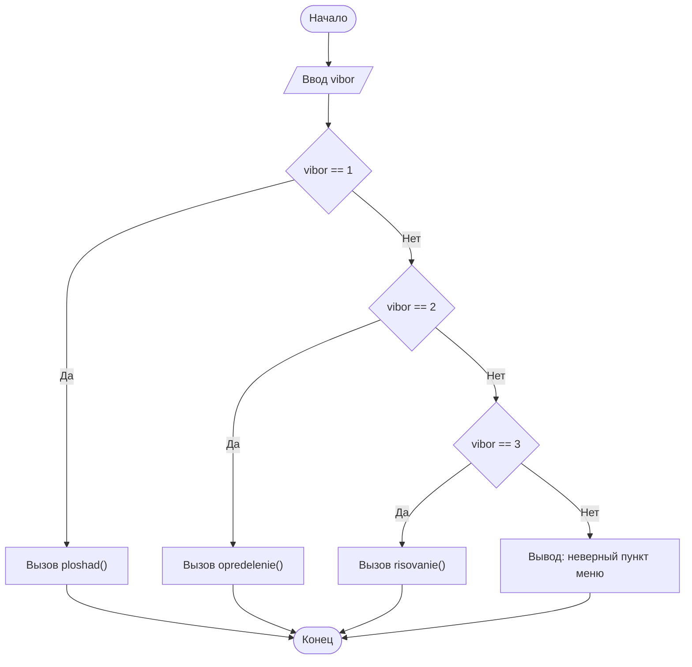

# Домашнее задание к работе 10

## Условие задачи

Составьте программу, которая для заданной фигуры (прямоугольника) предлагает меню выбора одной из операций: 1) рассчитать площадь; 2) вывести определение фигуры; 3) нарисовать фигуру. Для фигуры реализованы отдельные функции.

## 1. Алгоритм и блок-схема

**Алгоритм решения:**
1. НАЧАЛО
2. Вывести меню на экран (1 - площадь, 2 - определение, 3 - рисование).
3. Считать выбор пользователя.
4. ЕСЛИ выбор = 1, вызвать функцию ploshad().
5. ИНАЧЕ ЕСЛИ выбор = 2, вызвать функцию opredelenie().
6. ИНАЧЕ ЕСЛИ выбор = 3, вызвать функцию risovanie().
7. ИНАЧЕ вывести сообщение об ошибке.
8. КОНЕЦ

**Блок-схема:**


## 2. Реализация программы

Код программы находится в файле `main.c` в этом же репозитории.

## 3. Результаты работы программы

```text
1 - рассчитать площадь
2 - вывести определение фигуры
3 - нарисовать фигуру
выберите пункт меню: 3
введите ширину: 5
введите высоту: 3
введите символ для рисования: *
*****
*****
*****
```

## Информация о разработчике
Студент: Любых Егор Евгеньевич
Группа: бИЦТ-261
Вариант: 19
Дисциплина: Основы программирования и алгоритмизации
Руководитель: О. В. Минакова
